  

  
  

  

### `01` &nbsp;inventory

  

#### tech stack

  
   
  
   
  

<b>ai + ml</b> 
  
  
  
  
  
  
  
  
  
  
  
  

<b>web + glue</b> 
  
  
  
  

<code>&gt; open stack.log</code> &nbsp;where each tool shows up

 

| layer | tools | where I've used it |
|:--|:--|:--|
| **ai & llms** |      | [hallucination-hunter](https://github.com/sanchigoyal73/hallucination-hunter) (LLM answer auditing) · [Onyx](https://github.com/sanchigoyal73/Onyx) (AI that opens fix PRs) · [ai-pet-logger](https://github.com/sanchigoyal73/ai-pet-logger) (Claude-classified dev journal) |
| **ml & data** |       | NetWM, SIH 2026: forecasting network attacks with a world model; I built the feature pipeline |
| **languages** |  | TS for the web, Python for ML, C++ for DSA practice |
| **backend** |      | APIs, lead-form pipelines, map routes, model serving |
| **frontend** |        | property and real-estate sites for clients: [hp market](https://1-21.vercel.app) · [sab properties](https://sab-properties-swart.vercel.app) |
| **ship & test** |     | every project above, deployed on Vercel |

### `02` &nbsp;pinned files

  
  

  
  

### `03` &nbsp;how a project moves

  

### `04` &nbsp;commit log

  <!-- Generated by .github/workflows/snake.yml from scripts/isocal.py -->
  

  <!-- Generated by .github/workflows/snake.yml -->
  <picture>
    <source media="(prefers-color-scheme: dark)" srcset="https://raw.githubusercontent.com/sanchigoyal73/sanchigoyal73/output/github-snake-dark.svg" />
    <source media="(prefers-color-scheme: light)" srcset="https://raw.githubusercontent.com/sanchigoyal73/sanchigoyal73/output/github-snake.svg" />
    
  </picture>

  

