<!-- Animated ASCII banner (assets/voltbot.svg) -->
<p align="center">
  
</p>

<p align="center">
  
</p>

<p align="center">
  <a href="https://github.com/sanchigoyal73"></a>
  
</p>

```text
 ┌──────────────────────────────────────────────┐
 │  > whoami                                    │
 │    Sanchi Goyal · student / dev / builder    │
 │  > cat now.txt                               │
 │    building:  cool side projects             │
 │    learning:  something new every week       │
 │    ask me:    anything tech                  │
 └──────────────────────────────────────────────┘
```

### ⚡ Stack
<p>
  
</p>

### 🔥 Streak
<p align="center">
  
</p>

### 🏆 Trophies
<p align="center">
  
</p>

### 🗓️ Contributions, in 3D
<p align="center">
  <!-- Generated daily by .github/workflows/metrics.yml -->
  
</p>

### 🐍 The snake eats my commits
<p align="center">
  <!-- Generated by .github/workflows/snake.yml -->
  <picture>
    <source media="(prefers-color-scheme: dark)" srcset="https://raw.githubusercontent.com/sanchigoyal73/sanchigoyal73/output/github-snake-dark.svg" />
    <source media="(prefers-color-scheme: light)" srcset="https://raw.githubusercontent.com/sanchigoyal73/sanchigoyal73/output/github-snake.svg" />
    
  </picture>
</p>
