<p align="center">
  
</p>

<p align="center">
  <a href="https://github.com/sanchigoyal73"></a>
  
  
  <!-- socials go here, e.g.
  <a href="https://linkedin.com/in/YOUR_LINKEDIN"></a>
  -->
</p>

```text
 ┌─────────────────────────────────────────────────────────────┐
 │  $ whoami                                                   │
 │    sanchi goyal . 3rd-year student . delhi                  │
 │                                                             │
 │  $ cat now.txt                                              │
 │    building   a 3D portfolio with an interactive keyboard   │
 │    shipping   websites for real clients                     │
 │    team       NetWM @ SIH 2026, I own the feature pipeline  │
 │    ask me     Next.js, motion, three.js, scroll magic       │
 │                                                             │
 │  $ _                                                        │
 └─────────────────────────────────────────────────────────────┘
```

<p align="center">
  
</p>

### `01` &nbsp;the stack, and where it shows up

| layer | tools | where I've used it |
|:--|:--|:--|
| **languages** |  | TS for the web, Python for ML, C++ for DSA practice |
| **frontend** |  <br/>     | property and real-estate sites for clients: [hp market](https://1-21.vercel.app) · [sab properties](https://sab-properties-swart.vercel.app) |
| **3d & motion** |  <br/>     | my portfolio, built around an interactive 3D keyboard |
| **backend** |  <br/>   | APIs, lead-form pipelines, map routes, model serving |
| **ml & data** |  <br/>    | NetWM, SIH 2026: forecasting network attacks with a world model |
| **ai tooling** |  <br/>   | [ai-pet-logger](https://github.com/sanchigoyal73/ai-pet-logger): a CLI pet that journals your git work into Notion |
| **ship & test** |  <br/>  | every project above, deployed on Vercel |

### `02` &nbsp;how a project moves through my hands

```text
   idea                design               build                  ship
  ──────            ──────────           ───────────            ──────────
 ┌────────┐        ┌────────────┐       ┌─────────────┐        ┌───────────┐
 │ brief  │ ─────> │ references │ ────> │ Next.js /   │ ─────> │ Vercel    │
 │ + why  │        │ + layout   │       │ React + TS  │        │ + Actions │
 └────────┘        └────────────┘       └──────┬──────┘        └─────┬─────┘
                                               │                     │
                         ┌─────────────────────┼──────────┐          │
                         v                     v          v          v
                  ┌────────────┐      ┌─────────────┐  ┌───────┐  ┌──────────┐
                  │ motion     │      │ api         │  │ ml    │  │ commit   │
                  │ GSAP · 3D  │      │ Node · Fast │  │ torch │  │ small,   │
                  └────────────┘      └─────────────┘  └───────┘  │ often    │
                                                                  └──────────┘
```

### `03` &nbsp;commit log, visualised

<p align="center">
  
</p>

<p align="center">
  <!-- Generated daily by .github/workflows/metrics.yml -->
  
</p>

<p align="center">
  <!-- Generated by .github/workflows/snake.yml -->
  <picture>
    <source media="(prefers-color-scheme: dark)" srcset="https://raw.githubusercontent.com/sanchigoyal73/sanchigoyal73/output/github-snake-dark.svg" />
    <source media="(prefers-color-scheme: light)" srcset="https://raw.githubusercontent.com/sanchigoyal73/sanchigoyal73/output/github-snake.svg" />
    
  </picture>
</p>
